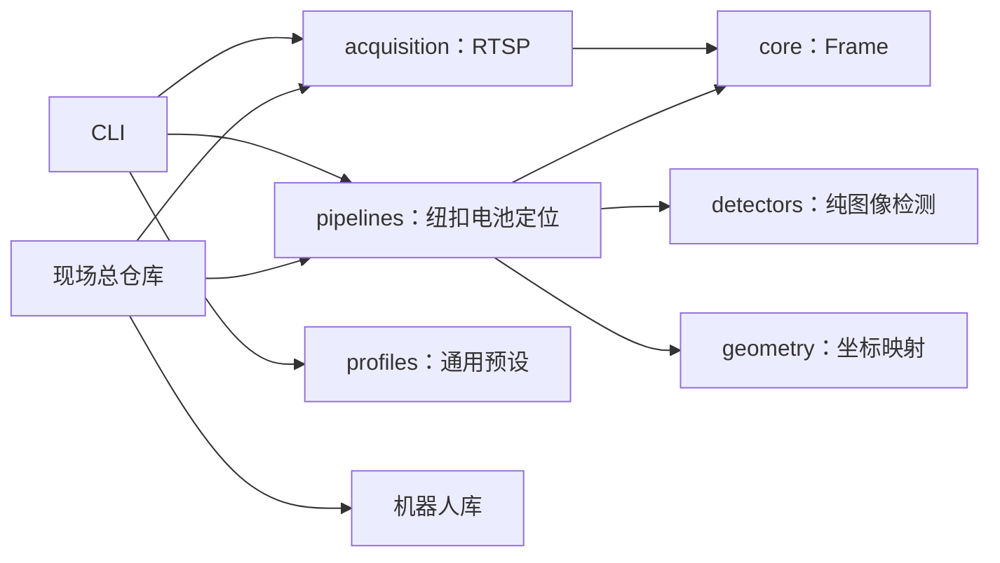

# 仓库架构与职责

本库是可被多个现场项目作为子模块或 Python 包使用的工具库。它拥有视觉能力与可复用知识，上层项目拥有现场配置和执行流程。

```text
industry_cv/
├── src/industry_cv/
│   ├── core/          # Frame 等共享数据契约
│   ├── acquisition/   # 相机/视频输入，目前为 RTSP
│   ├── detectors/     # 图像到目标，目前为纽扣电池
│   ├── geometry/      # 平面投影、标定与尺寸估计
│   ├── pipelines/     # 领域视觉管线：检测、稳定跟踪、定位
│   ├── profiles/      # 随安装包发布的通用预设与物料规格
│   ├── cli/           # 命令行输入/输出适配
│   └── visualization.py
├── examples/button_battery/  # LR41 演示、场景 ROI、上层消费示例
├── skills/                  # AI 操作入口，链接本库能力
├── knowledge/cases/         # 现场学习与证据，按案例归档
├── docs/                    # 架构及跨项目集成指南
├── tests/{unit,integration,regression,data}/
└── scripts/                 # 维护和分发验证工具
```

## 依赖方向



采集不依赖检测，几何不依赖物料或相机实现；定位管线消费 `Frame`，可以由 RTSP、ROS 图像适配器或其他来源提供。`ButtonBatteryPipeline` 明确其纽扣电池语义，不将现有特定逻辑包装成虚假的通用算法。

库导入不会打开相机、启动线程或发送机器人命令。`examples/` 的工具姿态与目标提案是上层用法示范，不属于视觉核心接口。新增检测器无需修改 RTSP 或几何模块；只在出现真实复用需要时抽取进一步的协议或基类。

## 配置归属

| 内容 | 归属 |
|---|---|
| 通用检测起始参数、LR41 名义尺寸 | 包内 `profiles/`，可被 wheel 访问 |
| 用于复现实验的 ROI、示例夹具参数 | `examples/<能力>/configs/`，明确只是演示 |
| 当前相机地址、密码、实际 ROI、标定、工具偏移 | 现场总仓库/本地配置 |
| 一次运行的帧、JSONL 和图像标注 | 现场数据目录；本地开发可用被忽略的 `artifacts/` |
| 少量可共享失败样例 | `tests/data/<能力>/`，记录来源与标注条件 |
| 方法、结论和实验依据 | `knowledge/cases/<日期-场景>/` |

不要从库中通过 `../examples` 或仓库 cwd 查找运行必需资源。通用预设统一经 `importlib.resources` 读取，用户配置通过显式文件参数/API 参数传入。复制预设后修改现场配置，不修改已安装包。

## 交付与兼容

- **wheel**：运行代码和通用预设；在没有 Git checkout 的环境也可使用 Python API / CLI。
- **源码仓库/源码包**：另外包含技能、知识、示例与测试；适用于现场子模块集成与知识回流。
- **稳定入口**：根包公开导出、CLI、文档化 JSON 协议；实现模块路径见迁移说明。
- **版本固定**：总仓库提交子模块指针，发布依赖固定版本；升级前用自己的现场样例与标定验收。

新增能力和版本管理见 [CONTRIBUTING](../CONTRIBUTING.md)，本次迁移见 [CHANGELOG](../CHANGELOG.md)。
