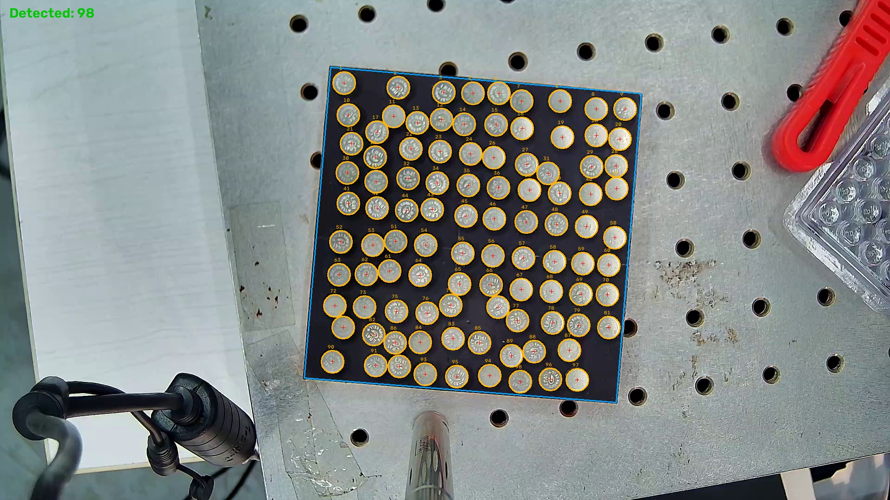

# 2026-11-26：RTSP 纽扣电池视觉验证

## 场景与接入

相机提供 `/stream0` 主码流，TCP，1920×1080。默认网络地址见站点接入说明，密码只通过环境变量传入。RTSP 路径及 TCP 方式参考 [ur15_crisp camera_node](https://github.com/yizhongzhang1989/ur15_crisp/tree/main/src/camera_node)。本库独立实现采集，不引入 ROS、Flask 或机器人控制依赖。

初始黑色取料板上可见 100 枚平放电池，直径约 48 像素，个别相互接触。板外有大量圆形安装孔、包装盘和其他设备。此次只验证黑色板有效取料区；包装盘不在抓取范围。电池真实型号、直径、相机内参、机器人对应点及平面高度尚未提供。

## 算法与发现

有效 ROI 内自适应阈值 → 提取外轮廓 → 优先拟合完整电池外缘 → 对不满足单体几何的区域用填充轮廓的距离峰值拆分 → 原始外缘拟合 → 半径、轴比、圆弧覆盖、拟合误差和局部对比度检查 → 去重与邻近/边界检查。

初始图直接做连通域只能得到 94 个区域，有 6 组接触电池被合并；拆分后得到 100 个目标。亮方块可能通过轴比与圆弧覆盖检查，因此增加归一化外缘残差约束，保留非圆干扰回归测试。

后续 300 帧试验中有 30 帧漏掉上部 `(958,199)` 附近电池。现场刻字和亮度变化使其单个外轮廓内部出现两个距离峰值。修复为**先验证完整外缘，只拆分单体拟合失败区域**；保留 `button_cells_edge_marking.jpg` 防止复发。这同时减少了不必要的距离变换计算。

采样过程中，右下角约 `(1300,766)` 和 `(1294,818)` 的两枚电池从画面中消失，新的现场图可见 98 枚。没有把计数变化直接当作漏检，而是对照原图确认；本任务未发送任何机器人运动指令。

## 验证证据

| 检查 | 实测结果 | 范围 |
|---|---|---|
| 初次实时试验 | 120/120 帧检出 100 枚 | 初版、初始静态摆放 |
| 最终真实图回归 | 100 枚、刻字变化图 100 枚、移出后图 98 枚 | 三张保留原图 |
| 最终实时试验 | 600/600 帧检出 98 枚，持续约 24.0 秒 | 移出后静态摆放 |
| 最终检测耗时 | 中位数 20.4 ms，95 分位数 22.3 ms | 本机 CPU，算法，不含解码/网络/机器人 |
| 最终追踪 | 共 98 个 ID，末帧 98 个稳定目标 | 本次会话；不跨重启 |
| 中心时间标准差 | 最大约 0.113 px | 静态重复性，不是物理定位精度 |
| 末帧几何拒绝原因 | 邻距不足 33 个，靠近边界 1 个 | 保留检测，但需上层评估可抓性 |
| 机器人坐标 | 全部未标定，`pickable=false` | 没有伪造机器人位置 |

[机器可读测量记录](metrics/button-battery-validation.json)保存软件版本、配置哈希与精确数值。`tests/data/button_battery/button_cells_100.json` 的中心由算法辅助后逐点目视核对、取近似整数；这是开发回归标签，**不是独立标注测试集或亚像素计量真值**。近似标签容差 3 像素，离线检查包含一一匹配，重复检测会计为误检。



实时原始输出保存在本机忽略目录 `artifacts/live_validation.jsonl`、`artifacts/final_live_fixed.jsonl`；初次试验的原图/标注图在 `artifacts/live_validation/`。本记录及最小原图进入仓库，避免将完整采样堆进版本历史。

## 复现

```bash
industry-cv detect tests/data/button_battery/button_cells_100.jpg \
  --config examples/button_battery/configs/vision.json \
  --output artifacts/result.json --annotated artifacts/result.jpg
python examples/button_battery/evaluate.py --image tests/data/button_battery/button_cells_100.jpg \
  --labels tests/data/button_battery/button_cells_100.json \
  --config examples/button_battery/configs/vision.json --repeat 50
PYTEST_DISABLE_PLUGIN_AUTOLOAD=1 pytest -q
# 按 README 设置相机密码后，检查实时计数与当下画面是否一致。
industry-cv stream --config examples/button_battery/configs/vision.json \
  --frames 600 > artifacts/recheck.jsonl
```

## 适用边界与下一现场工作

目前证明的是该深色板、当前尺度、接近正视的平放电池识别与像素定位。邻接拆分可处理完整外缘大部分可见的接触目标；严重重叠、堆叠、边缘遮挡和低对比度仍可能拒绝或漏检。同尺寸金属圆片无法仅凭几何区分。当前没有不同物料批次、复杂背景或独立生产验收集的统计结果。

主机接收时间不能代表曝光时间。600 帧静态试验不证明移动输送带跟踪能力，也不证明长期断流率或生产节拍。断流重连和资源释放通过受控模拟测试；本次未中断现场网络。

接入机械臂需在上层完成真实平面标定、独立点位误差验证、工具尺寸/姿态/高度与轨迹规划，以及抓取结果确认。详细流程见 [标定说明](../../../docs/guides/calibration.md)。本库已经提供所需投影和结果接口；相机/物料/位姿变化后应重新验证配置与标定。

## LR41 确认后的估计模式与侧光复测

用户确认型号 LR41，并明确要求不再等待提问，先使用默认值/估计值运行，再逐步换成真值。因此新增按名义直径 7.9 mm、厚度 3.6 mm 建立工作平面坐标的模式。源头标记为 `estimated`，定位误差保持未知；不把工作平面原点称作物理机器人基座。启动方法见 [LR41 快速运行](../../../examples/button_battery/README.md)。前文中的“待标定”描述对应早期阶段，不再是运行估计模式的障碍。

期间现场由均匀照明变为明显侧光和阴影，所有 100 枚电池可见。旧全局阈值在一个新样例中仅检出 68 枚，实时计数也随反光变化。新增按目标尺度估计局部照度并做除法归一化；在 Otsu 主阈值之外，用 90% / 80% 阈值补充暗外缘。优先保留主阈值的拟合结果，补检要求几何质量分至少 0.5，并抑制与已有中心重合的候选，避免把阴影之间的空隙当作电池。

真实侧光照片与后续闪烁帧分别保存为 `button_cells_side_light.jpg`、`button_cells_shadow_flicker.jpg`，均加入一一匹配的回归测试。图像在相机/板的微小位移后使用 12 像素关联上限，只验证对象对应关系；该上限不是定位误差指标。

最终重新采集的 **600/600 帧均检出 100 枚**，持续约 35.9 秒；末帧全部 100 个目标稳定，69 个通过当前邻距/边界条件。算法耗时中位数 **52.4 ms**，95 分位数 **56.2 ms**，约 19 次检测/秒；该版本比早期均匀光版本做了更多外缘恢复，不能继续引用早期 20.4 ms 作为当前处理速度。

估计尺度约 **0.1668 mm/px**，取料区中心约 `(1019.9,508.2)` 像素；工作坐标 X 向图像右侧、Y 向图像上方，表面高度默认 3.6 mm。这些是当前图像与名义规格构建的估计值，不是实测相机外参。

上层集成示例另以真实 RTSP 连续运行 120 帧，输出 `pick_target_proposals`，包含目标编号、时间戳、估计来源、接近姿态和接触姿态。默认工具朝下，接近偏移 20 mm；`execution_mode=preview` 表示此示例验证数据交付，未驱动物理机械臂。实际流程和机器人动作仍归现场总仓库。

机器可读结果：[LR41 估计模式验证](metrics/lr41-estimated-validation.json)。原始 JSONL 保存在 `artifacts/lr41_final_live.jsonl` 与 `artifacts/target_requests.jsonl`。将来接入真实标定文件时保留相同结果结构，以 `source=correspondences` 替换估计来源。
